# Secure Network Lab
A Cisco Packet Tracer lab demonstrating VLAN segmentation, inter-VLAN routing, traffic filtering with extended ACLs, connectivity testing and Spanning Tree Protocol (STP).

## Network Topology
The lab contains one Cisco 2911 router, one Cisco 2960 switch and three PCs. Router-on-a-stick routing enables communication between the VLANs, while an extended ACL restricts traffic from the Staff subnet to the Servers subnet.

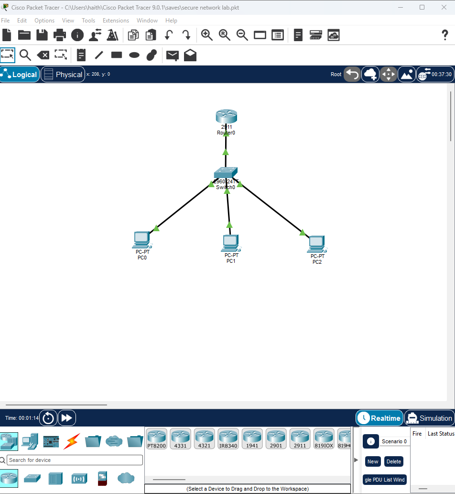

## Network Design
### VLANs
| VLAN ID | Name | Switch port | Subnet |
|---------|------|-------------|--------|
| 10 | ADMIN | Fa0/1 | 192.168.10.0/24 |
| 20 | STAFF | Fa0/2 | 192.168.20.0/24 |
| 30 | SERVERS | Fa0/3 | 192.168.30.0/24 |

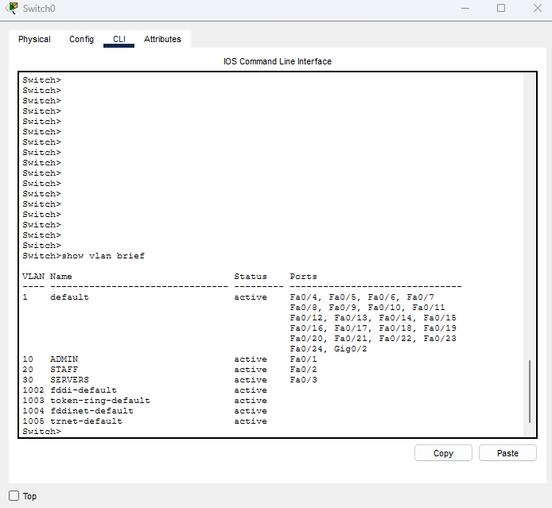

### IP Addressing 
| Device | IPv4 address | Subnet mask | Default gateway |
|---|---|---|---|
| PC0 — Admin | 192.168.10.10 | 255.255.255.0 | 192.168.10.1 |
| PC1 — Staff | 192.168.20.10 | 255.255.255.0 | 192.168.20.1 |
| PC2 — Servers | 192.168.30.10 | 255.255.255.0 | 192.168.30.1 |

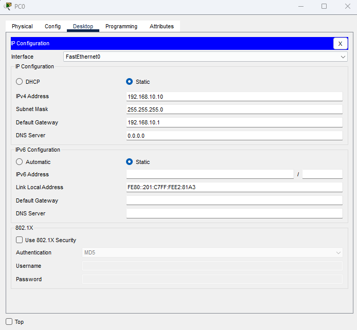

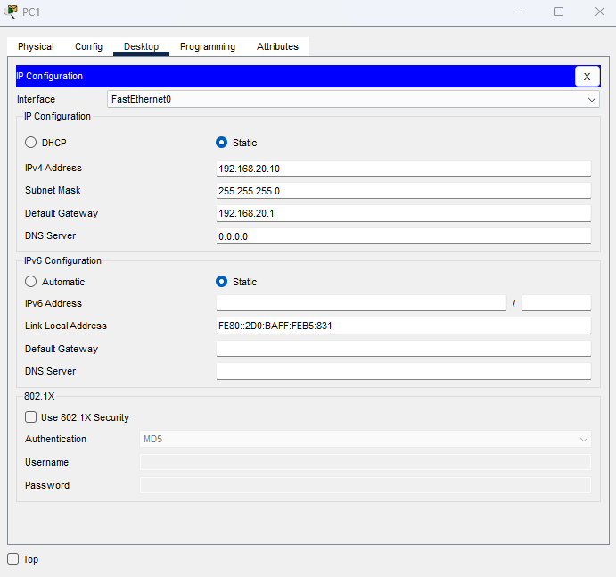

## Trunking and Inter-VLAN Routing 
The switch-to-router link uses IEEE 802.1Q trunking to carry VLANs 10, 20 and 30. Router sub interfaces on GigabitEthernet0/0 provide the default gateway for each VLAN.

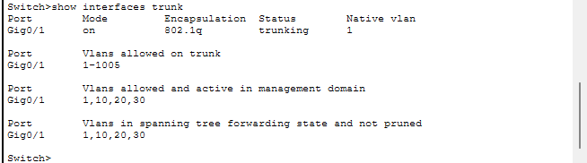

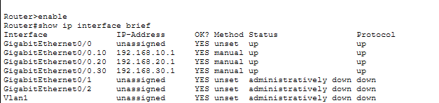

## Security: Extended ACL
The extended ACL BLOCK-STAFF-TO-SERVERS is applied outbound on router sub interface GigabitEthernet0/0.30.

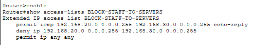

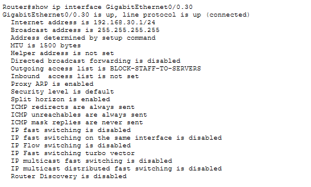

The ACL denies IP traffic from 192.168.20.0/24 (Staff) to 192.168.30.0/24 (Servers), while permitting ICMP echo replies in that direction and allowing other traffic not matched by the deny rule.

Security limitation: Cisco ACLs are stateless. The ICMP exception enables the tested Servers-to-Staff ping, but it does not provide stateful inspection or automatically allow return traffic for TCP and UDP connections.

## Connectivity Test Results

| Test | Observed result |
|---|---|
| Staff → Servers | Blocked; 100% packet loss |
| Staff → Admin | Successful; 0% packet loss |
| Admin → Servers | Successful; 0% packet loss |
| Servers → Staff | Successful; 0% packet loss |
### Staff to Servers — Blocked

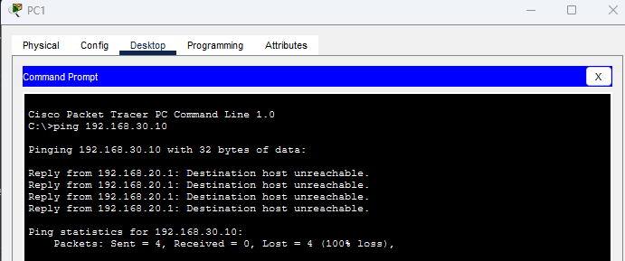

### Staff to Admin — Allowed

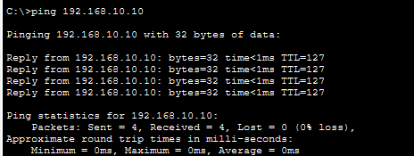

### Admin to Servers — Allowed

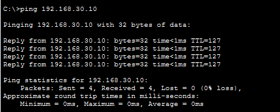

### Servers to Staff — ICMP Reply Exception

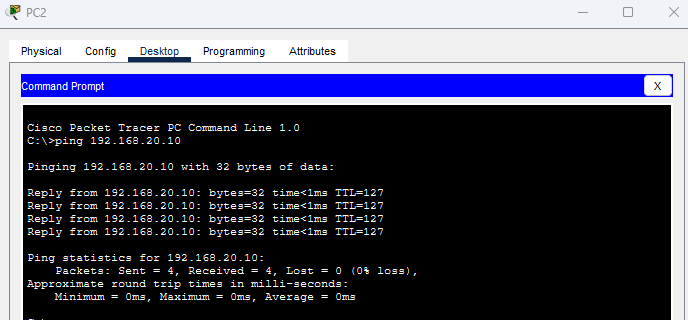

### ACL Match Counters

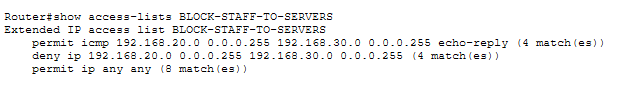

These results are based on the captured Packet Tracer ping tests.

## Spanning Tree Protocol
The switch's show spanning-tree output identifies the switch as the root bridge for the VLANs visible in the captured output. Because the topology contains only one switch, this demonstrates STP operation but does not test root bridge election between multiple switches.
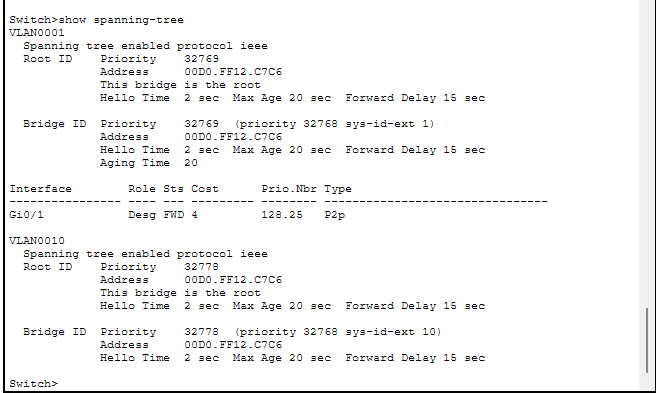

